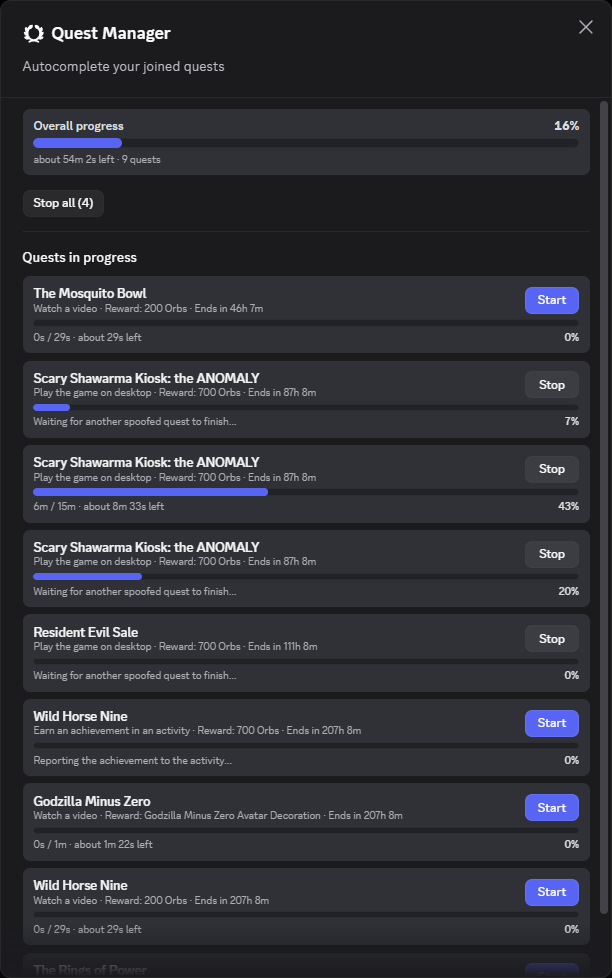
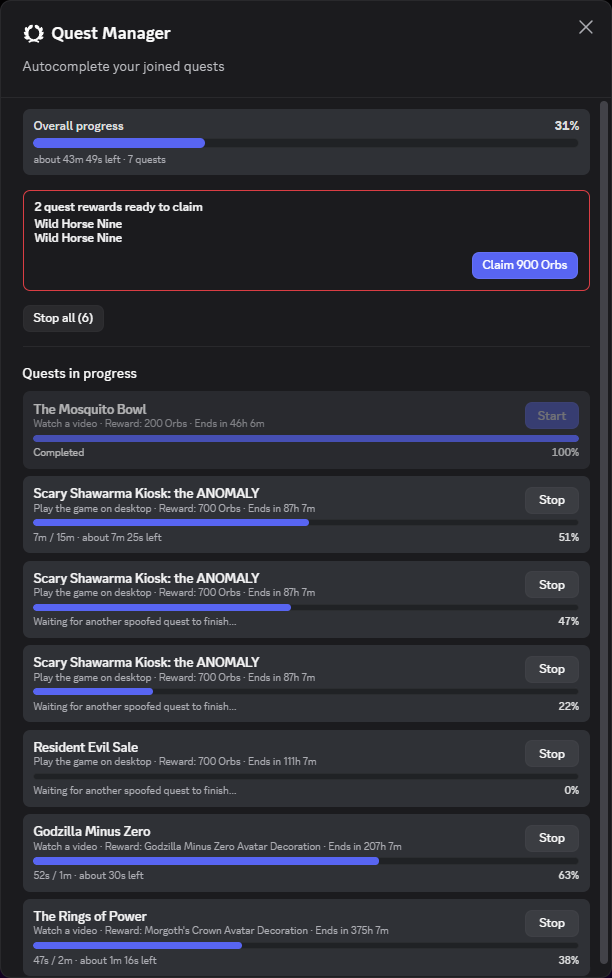
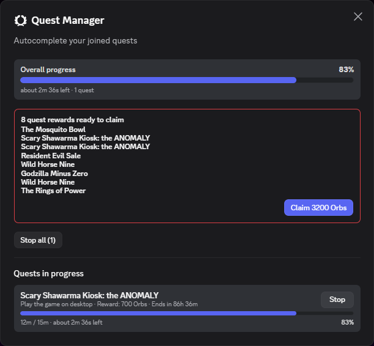

<div align="center">


# QuestAutoComplete

**A Quest Manager for [Vencord](https://github.com/Vendicated/Vencord).**
Adds a button to the server rail that autocompletes your joined Discord Quests, with live progress and one-click reward claiming.


</div>

> [!CAUTION]
> **Automating Quests is against the Discord Terms of Service, and Discord has been enforcing it.**
> Reported consequences include losing unclaimed Orbs, a two week ban on completing Quests, having Quest access revoked entirely, or wider account restrictions.
> Use this at your own risk. If Discord warns you or a Quest suddenly disappears, stop using the plugin.

> [!IMPORTANT]
> **This project is for educational purposes only.** It exists to study how Discord's Quest system and client internals work. It is not intended to be used to cheat or to violate Discord's Terms of Service, and the author takes no responsibility for how it is used.

## Preview

<div align="center">
<table>
  <tr>
    <td width="33%"></td>
    <td width="33%"></td>
    <td width="33%"></td>
  </tr>
</table>
</div>

## Features

- **Rail button** sitting under Favorites, with a live progress fill, a tooltip showing running quests and time left, and a badge when rewards are ready to claim.
- **Quest Manager modal** with overall progress, per-quest progress bars, reward and expiry chips, and a highlight for quests that are about to expire.
- **Autocomplete all** or start and stop single quests.
- **Accept quests** straight from the modal.
- **Claim rewards** from the modal. Claims are spaced out and retried when Discord rate limits them.
- **Toast** when a quest finishes (optional).
- Nothing is sent until you press a button in the modal, and captchas are never solved for you.

## Supported quest types

| Task | Automated | Needs desktop app |
| --- | :---: | :---: |
| `WATCH_VIDEO` | ✅ | |
| `WATCH_VIDEO_ON_MOBILE` | ✅ | |
| `PLAY_ON_DESKTOP` | ✅ | ✅ |
| `STREAM_ON_DESKTOP` | ✅ | ✅ |
| `PLAY_ACTIVITY` | ✅ | |
| `ACHIEVEMENT_IN_ACTIVITY` | ✅ | ✅ |
| `ACHIEVEMENT_IN_GAME` | ❌ | |
| `PLAY_ON_XBOX` / `PLAY_ON_PLAYSTATION` | ❌ | |

`ACHIEVEMENT_IN_ACTIVITY` briefly authorizes the activity to your account, reports the progress, and revokes the authorization again. It is controlled by the *Achievement bypass* setting.

`ACHIEVEMENT_IN_GAME` has no endpoint in the client that reports an in-game achievement, and the console tasks only exist on console.

## Installation

Vencord has no official way to install third party plugins, so you need to build it from source. See the [Vencord custom plugin guide](https://docs.vencord.dev/installing/custom-plugins/).

```bash
git clone https://github.com/Vendicated/Vencord
cd Vencord
pnpm install --frozen-lockfile
mkdir src/userplugins
```

Download this plugin into `src/userplugins/questAutoComplete`, then build:

```bash
git clone https://github.com/xhvsh/questAutoComplete src/userplugins/questAutoComplete
pnpm build
pnpm inject
```

Restart Discord, open **Settings → Vencord → Plugins** and enable **QuestAutoComplete**.

> [!NOTE]
> The rail button is added through a patch, so Discord needs a reload the first time you enable the plugin.

## Settings

| Setting | Default | Description |
| --- | :---: | --- |
| Notify on complete | on | Show a toast when a quest finishes. |
| Spoof app focus | on | Pretend the window is always focused. Claiming a reward fails while the window is in the background, so leave this on if claiming fails when you alt tab away. |
| Video progress step | 7 | How much video progress, in seconds, to send in one request. Lower values send more requests, higher values send fewer. |
| Achievement bypass | on | Complete `ACHIEVEMENT_IN_ACTIVITY` quests by reporting the progress through the activity backend. Turn it off if Discord warns you about your Quest access. |

## Usage

1. Accept a quest in Discord, or from the **Available quests** list in the modal.
2. Click the quest button in the server rail.
3. Press **Autocomplete all**, or **Start** on a single quest.
4. When the banner says rewards are ready, press **Claim**. If Discord asks for a captcha, solve it and press claim again.

## Project layout

| File | Purpose |
| --- | --- |
| `index.tsx` | Plugin definition and the `GuildsBar` patch that renders the rail button. |
| `engine.ts` | Runs quests, polls the quest store, claims rewards, spoofs window focus. |
| `native.ts` | Main process helper for the activity backend, which the renderer's CSP blocks. Only used for `ACHIEVEMENT_IN_ACTIVITY`. |
| `QuestModal.tsx`, `QuestButton.tsx`, `QuestIcon.tsx` | UI. |
| `quests.ts`, `questStore.ts`, `types.ts` | Quest data helpers and types. |
| `settings.ts`, `PluginInfo.tsx` | Settings and the plugin's about section. |
| `style.css` | Styles. |
| `assets/icon.png` | Plugin icon. |

## Disclaimer

This project is shared for educational purposes. It is not affiliated with or endorsed by Discord or Vencord. It is provided as is, without warranty, and you are responsible for how you use it.

## License

GPL-3.0-or-later, same as Vencord.
